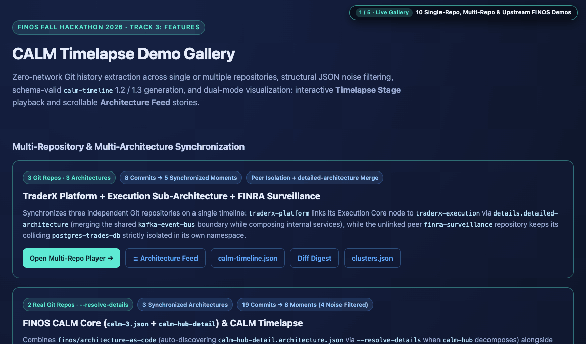

# CALM Timelapse (`calm-timelapse`)

**Hackathon Track:** Track 3: Features · **Live GitHub Pages Gallery:** [**finos-hack.github.io/fall-hackathon-2026-mu**](https://finos-hack.github.io/fall-hackathon-2026-mu/)

[](https://finos-hack.github.io/fall-hackathon-2026-mu/)

> **Try Live in Browser (Zero Install):** [**Demo Gallery**](https://finos-hack.github.io/fall-hackathon-2026-mu/) · [**Upstream FINOS TraderX Stage**](https://finos-hack.github.io/fall-hackathon-2026-mu/demos/finos-traderx/finos-traderx.timelapse.html) · [**3-Repo Federated Stage**](https://finos-hack.github.io/fall-hackathon-2026-mu/demos/multi-repo/multi-repo.timelapse.html) · [**Reverse-Chronological Feed (`#feed`)**](https://finos-hack.github.io/fall-hackathon-2026-mu/demos/finos-traderx/finos-traderx.timelapse.html#feed) · [**72s HD Walkthrough Video (`.mp4`)**](https://finos-hack.github.io/fall-hackathon-2026-mu/assets/calm-timelapse-demo.mp4)

Reviewers and auditors regularly need to determine what an architecture looked like on a past date, why it changed, and what breaks if a component fails. In upstream `@finos/calm-cli`, `calm timeline -a` requires manually pre-saved versioned files on disk (`arch-1.0.0.json`, `arch-2.0.0.json`), and `calm diff --timeline` outputs text or Markdown tables. **CALM Timelapse** extracts timelines directly from Git: it walks `git log --follow -M30%` across one or multiple repositories, filters pure JSON formatting and key-reordering commits, emits schema- and Spectral-validated `calm-timeline` (`1.2` and `1.3`) artifacts with `SHA-256`-verified snapshots, and renders an offline single-file HTML/SVG player with **Timelapse Stage**, **Architecture Feed**, and **Multi-Hop CALM Blast Radius** analysis. It makes zero runtime network calls.

## What Judges Can Evaluate

| Capability | Technical Mechanism | Live Demo / Source |
|---|---|---|
| **Git-Native Timeline Synthesis** | Walks `git log --follow -M30%`, filters formatting-only commits while retaining referenced flow URLs and `items` to `prefixItems` / `uniqueId` to `unique-id` pattern migrations, and classifies CALM architectures (`*.architecture.json`) vs. patterns (`*.pattern.json`). | [API Gateway Pattern](https://finos-hack.github.io/fall-hackathon-2026-mu/demos/api-gateway/api-gateway.timelapse.html) · [`src/calm-diff.ts`](./src/calm-diff.ts) |
| **Multi-Repo Federation & Composition** | Isolates unlinked peer repos by namespace (`<sourceId>--<unique-id>`) even on colliding node IDs (`postgres-trades-db`), and merges shared boundary nodes (`⇄`) only when linked via `node.details["detailed-architecture"]` or `--resolve-details`. | [3-Repo Federated Stage](https://finos-hack.github.io/fall-hackathon-2026-mu/demos/multi-repo/multi-repo.timelapse.html) · [`src/federation.ts`](./src/federation.ts) |
| **Multi-Hop CALM Blast Radius** | Click any node in Stage to compute `1-HOP` and `2-HOP+` impact across CALM relationship semantics (`All Impacted`, `Dependents / Failure Cascade`, `Downstream Flow`), impacted `flows`, at-risk `controls`, `Isolate` zoom, and temporal delta (`±Δ vs prev`) across commits. | Click any node in [TraderX Stage](https://finos-hack.github.io/fall-hackathon-2026-mu/demos/finos-traderx/finos-traderx.timelapse.html) · [`src/timelapse-html.ts`](./src/timelapse-html.ts) |
| **Upstream `finos/traderx` + FDC3 `2.2`** | `--from-traderx` converts 13 progressive states (`001`–`014`), 22 Spec-Kit requirements into CALM `1.3` `controls`, 8 ADRs, and 135 commit references, and translates FDC3 contracts (`contract-delta.md` + `appd.v2.json`) into validated CALM `interfaces` and 3 `flows`. | [Upstream TraderX Stage](https://finos-hack.github.io/fall-hackathon-2026-mu/demos/finos-traderx/finos-traderx.timelapse.html) · [`src/traderx-importer.ts`](./src/traderx-importer.ts) |
| **Dual Views, Audit Queries & Monorepo Scale** | Toggle between **Timelapse Stage** (`As-Of Date` `YYYY-MM-DD` lookup, arbitrary baseline moment diff) and reverse-chronological **Architecture Feed** (`#feed`, `Save SVG`). Aspect-ratio-balanced column packing scales cleanly to 160+ node / 280+ relationship monorepo graphs. | [TraderX `#feed`](https://finos-hack.github.io/fall-hackathon-2026-mu/demos/finos-traderx/finos-traderx.timelapse.html#feed) |
| **Tamper-Evident Provenance & Upstream CI Parity** | Writes verbatim Git-blob `SHA-256` hashes (`snapshot-sha256`), extracts node and relationship `controls` (scoping colliding inline keys as `<ownerId>:<controlId>`), enforces `0..N-1` AI cluster coverage, and runs 24 `@finos/calm-cli@1.72.0` validation checks in CI (`0` errors, `0` warnings). | [CI Workflow](./.github/workflows/ci.yml) · [`src/validator.ts`](./src/validator.ts) |

## Installation

OS X & Linux:

```sh
git clone https://github.com/finos-hack/fall-hackathon-2026-mu.git
cd fall-hackathon-2026-mu
npm install
npm run build
```

Windows (PowerShell):

```powershell
git clone https://github.com/finos-hack/fall-hackathon-2026-mu.git
Set-Location fall-hackathon-2026-mu
npm install
npm run build
```

## Usage example

### 1. Zero-AI Deterministic Git Extraction (Air-Gapped Ready)

Point `calm-timelapse` at any Git-tracked CALM architecture or pattern file to extract structural history, write point-in-time snapshot JSONs, validate the resulting `calm-timeline` document, and render an offline HTML player:

```sh
node dist/cli.js \
  --from-git path/to/architecture.calm.json \
  -o timeline/architecture.timeline.json \
  --snapshots-dir timeline/snapshots \
  --timelapse timeline/architecture.timelapse.html \
  --validate
```

- **Deterministic commit clustering:** Without `--clusters`, consecutive structural commits by the same author within a 14-day window group into one moment until a commit adds or removes a node, flow, control, or co-changed ADR.
- **Monorepo ADR & filename handling:** Retains co-changed `docs/adr/*.md` files in monorepo pull requests (up to 250 changed files per commit, while ignoring bulk seed commits with `>10` ADRs) and qualifies generic root filenames (`architecture.calm.json`, `calm.json`) as `<repo>/<file>` without leaking local host paths.

### 2. Synchronized Multi-Repo & Multi-Architecture Playback (`--from-git <files...>` / `--resolve-details`)

Pass multiple CALM files across separate Git repositories (with optional `Label=path` display labels) or pass `--resolve-details` to auto-discover same-repo `details.detailed-architecture` child files:

```sh
node dist/cli.js \
  --from-git \
    "TraderX Platform=../traderx-platform/architecture/platform.calm.json" \
    "TraderX Execution=../traderx-execution/calm/execution-detail.calm.json" \
    "FINRA Surveillance=../finra-surveillance/calm/surveillance.calm.json" \
  -o timeline/federated.timeline.json \
  --snapshots-dir timeline/snapshots \
  --timelapse timeline/federated.timelapse.html \
  --validate \
  --validate-snapshots
```

- **Strict peer namespace isolation:** Unlinked architectures never merge nodes, even when two repositories declare the same `unique-id` (`postgres-trades-db`). Nodes are namespaced per source (`<sourceId>--<unique-id>`) and rendered with repository badges and a **Project** filter in the toolbar.
- **Canonical `detailed-architecture` composition:** Nodes merge **only** when a parent node explicitly references a child architecture through `node.details["detailed-architecture"]`. Shared boundary nodes (`kafka-event-bus`, `mongodb`) merge canonically (`⇄`), internal child services attach under the parent node via a synthesized CALM `composed-of` relationship, and both singular `interface` and plural `interfaces` endpoint references remap cleanly.

### 3. Diff Digest + Approved IDE Assistant (`--emit-digest` / `--clusters`)

Regulated environments typically block CLI tools from sending architecture JSON to external LLM endpoints. Matching `calm init-ai`, `calm-timelapse` exports a compact local diff digest (`--emit-digest`) and ships a workspace skill ([`skills/calm-timelapse/SKILL.md`](./skills/calm-timelapse/SKILL.md)) so an approved IDE assistant can group commits into named phases (`clusters.json`):

```sh
# Step 1: Export a compact structural diff digest (zero network calls)
node dist/cli.js --from-git architecture.calm.json --emit-digest timeline/digest.json

# Step 2: Hand timeline/digest.json to your approved IDE assistant to produce clusters.json,
#         then build the validated timeline and interactive player:
node dist/cli.js \
  --from-git architecture.calm.json \
  --clusters timeline/clusters.json \
  -o timeline/architecture.timeline.json \
  --snapshots-dir timeline/snapshots \
  --timelapse timeline/architecture.timelapse.html \
  --validate \
  --validate-snapshots
```

Example `clusters.json` covering structural commit indices `0..2`:

```json
[
  {
    "startIndex": 0,
    "endIndex": 0,
    "uniqueId": "core-diff-foundation",
    "name": "Core Structural Diff Foundation",
    "description": "Establishes the initial Git blob extractor and structural CALM diff engine."
  },
  {
    "startIndex": 1,
    "endIndex": 2,
    "uniqueId": "zero-network-digest-and-timelapse-player",
    "name": "Zero-Network Digest and Timelapse Player",
    "description": "Adds digest export, contiguous cluster validation, and single-viewport SVG playback."
  }
]
```

**Safeguards against malformed assistant output:** `validateClusterSpecs` enforces contiguous, non-overlapping coverage from `0` to `N - 1` (`startIndex = 0`, each next `startIndex = prev.endIndex + 1`, final `endIndex = N - 1`). Any gap, overlap, reversed range, or uncovered trailing commit aborts immediately with a diagnostic error. Every architecture snapshot is written verbatim from Git blobs with its `SHA-256` hash recorded in both `digest.commits[].snapshotSha256` and `moment.metadata["snapshot-sha256"]`, never generated by an assistant.

#### AI Workflow Evidence

Below is an actual end-to-end run against FINOS CALM's own self-architecture (`calm/architecture/calm-3.json` in `finos/architecture-as-code`, stored in [`docs/demos/calm-self/`](./docs/demos/calm-self/)):

1. **Sample Digest ([`calm-self.digest.json`](./docs/demos/calm-self/calm-self.digest.json), abbreviated to commits `0..1` of `0..4`):**

```json
{
  "schemaVersion": "1.0",
  "sourceFile": "calm-3.json",
  "latestCommitDate": "2026-07-25",
  "stats": {
    "totalCommitsScanned": 8,
    "validSnapshotsParsed": 7,
    "noiseCommitsFiltered": 2,
    "structuralCommitsRetained": 5
  },
  "commits": [
    {
      "index": 0,
      "shortSha": "f1486acb",
      "date": "2025-12-23",
      "subject": "docs(calm): Define CALM in CALM",
      "summaryLine": "Initial baseline with 8 node(s), 8 relationship(s)",
      "snapshotSha256": "296c44d1450f024d446d9d7c211288fa254232123b80784f8f8033d25d297ee0",
      "changes": ["Added node CALM CLI (calm-cli)", "Added node CALM Hub API (calm-hub)", "..."]
    },
    {
      "index": 1,
      "shortSha": "784858e7",
      "date": "2025-12-23",
      "subject": "docs(calm): remove unwanted hallucinations",
      "summaryLine": "~4 node(s), ~3 rel(s)",
      "snapshotSha256": "540708fe3de3780bb03c8f778f24d5af95f1f8747786438122694b9687929cc3",
      "changes": ["Modified node CALM CLI (calm-cli) [interfaces]", "Modified relationship cli-to-hub", "..."]
    }
  ]
}
```

2. **Prompt Handed to the Approved IDE Assistant (with [`skills/calm-timelapse/SKILL.md`](./skills/calm-timelapse/SKILL.md)):**

```text
Read docs/demos/calm-self/calm-self.digest.json and follow skills/calm-timelapse/SKILL.md to write
docs/demos/calm-self/calm-self.clusters.json. Cover structural commit indices 0..4 contiguously with
zero gaps or overlaps, use 3-7 word executive phase names (no conventional-commit prefixes), and write
concise narratives citing concrete CALM node, relationship, and flow IDs without mechanical count tokens.
```

3. **Assistant's Accepted Output ([`calm-self.clusters.json`](./docs/demos/calm-self/calm-self.clusters.json)):**

```json
[
  {
    "startIndex": 0,
    "endIndex": 1,
    "uniqueId": "core-cli-hub-and-vscode-baseline",
    "name": "Core CLI, Hub, and VSCode Baseline",
    "description": "Models FINOS CALM in CALM with calm-cli, calm-vscode, calm-hub, calm-hub-ui, and mongodb inside calm-hub-system and vscode, then refines interface bindings across cli-to-hub, hub-to-db, and hub-ui-to-hub."
  },
  {
    "startIndex": 2,
    "endIndex": 3,
    "uniqueId": "operational-publish-and-ide-flows",
    "name": "Operational Publish and IDE Flows",
    "description": "Introduces end-to-end behavioral flows—Publish Architecture, Browse Architectures, and Validate Architecture in IDE—capturing sequenced transitions from calm-user through calm-cli and calm-hub-ui to mongodb."
  },
  {
    "startIndex": 4,
    "endIndex": 4,
    "uniqueId": "calm-studio-and-validation-server",
    "name": "CalmStudio and Validation Server Expansion",
    "description": "Expands the platform with browser-based calm-studio and standalone calm-server exposing calm-server-validate-api, while linking calm-hub to its internal layered architecture specification."
  }
]
```

4. **Rejected Malformed Output & Exact Validator Error:** If the assistant omits commit index `2` (`77749fa4`), `calm-timelapse` aborts before writing any timeline or snapshots:

```json
[
  { "startIndex": 0, "endIndex": 1, "uniqueId": "core-cli-hub-and-vscode-baseline", "name": "Core CLI, Hub, and VSCode Baseline" },
  { "startIndex": 3, "endIndex": 4, "uniqueId": "calm-studio-and-validation-server", "name": "CalmStudio and Validation Server Expansion" }
]
```

```text
$ node dist/cli.js --from-git ../finos/calm/architecture/calm-3.json --clusters calm-self.bad.clusters.json
Error: Invalid cluster definitions (expected a non-empty JSON array covering commit indices 0..4 contiguously without gaps or overlaps): clusters[1].startIndex is 3, expected 2 (gap skipping commit index 2).
```

### 4. Upstream FINOS TraderX Import (`--from-traderx <repoDir>`) — Translates FDC3 Contracts into Validated CALM

Import a local clone of [`finos/traderx`](https://github.com/finos/traderx) directly into CALM `1.3` snapshots, a Spectral-clean `calm-timeline`, and an interactive player. This converts FINOS TraderX Spec-Kit artifacts (`catalog/state-catalog.json`, `specs/*/system/architecture.model.json`, `system-requirements.md`, `requirements/nonfunctional-delta.md`, `docs/adr/*.md`) and **translates FDC3 contracts into validated CALM** (`specs/014-fdc3-intent-interoperability/contracts/contract-delta.md` + `appd.v2.json` into CALM `1.3` `interfaces` and `flows`):

```sh
node dist/cli.js \
  --from-traderx ../traderx \
  -o docs/demos/finos-traderx/finos-traderx.timeline.json \
  --snapshots-dir docs/demos/finos-traderx/snapshots \
  --emit-digest docs/demos/finos-traderx/finos-traderx.digest.json \
  --timelapse docs/demos/finos-traderx/finos-traderx.timelapse.html \
  --validate \
  --validate-snapshots
```

- **Translates FDC3 Contracts into Validated CALM:** Parses `contract-delta.md` and `appd.v2.json` (`traderx-intent-launcher-1`) into CALM `1.3` node `interfaces` wired across `connects` relationships (`listens-for`: `ViewOrders`, `TraderX.CreateTradeTicket`, `TraderX.CreateOrderTicket`; `raises`: `ViewChart`, `ViewQuote`; contexts: `fdc3.instrument`, `fdc3.account`) plus 3 schema- and Spectral-validated CALM `flows` (`flow-fdc3-outbound-instrument-and-chart-intent`, `flow-fdc3-inbound-ticket-launch-to-execution`, `flow-fdc3-view-orders-and-realtime-blotter`).
- **Real Spec-Kit Governance to 22 Progressive CALM `controls`:** Parses `system-requirements.md` and `nonfunctional-delta.md` across States `001`–`014` into architecture-level and node-level CALM `1.3` `controls` (pre-publish trade validation, NATS account-scoped subject isolation, `C1`/`C2`/`C3` GHCR release provenance, auditable order-matcher logs, FDC3 public-symbol data minimization, Sail sidecar ingress isolation, and `GHSA-w5hq-g745-h8pq` dependency override).

### 5. Interactive Multi-Hop CALM Blast Radius & Large-Graph Scale

Click any active node in **Timelapse Stage** (or call `computeBlastRadius(nodes, edges, flows, controls, originId, mode)` programmatically from `dist/index.js`) to inspect failure and coupling propagation at the selected commit:

- **Three CALM-aware traversal modes:**
  - `All Impacted`: Traverses `connects`, `interacts`, `deployed-in`, and `composed-of` edges bidirectionally for full coupling surface.
  - `Dependents (Failure Cascade)`: Reverses `connects` and `interacts` edges (`callee -> caller`), propagates `deployed-in` from infrastructure host to hosted workloads (`container -> nodes`), and propagates `composed-of` across parent/child boundaries.
  - `Downstream Flow`: Follows outbound `source -> destination` edges plus hosted/child workloads to trace data or payload propagation.
- **Flows, controls & temporal delta:** Classifies nodes as `⚡ ORIGIN`, `1-HOP` (direct), or `2-HOP+` (transitive); lists every CALM `flow` whose transitions cross an impacted relationship; surfaces at-risk node and relationship `controls` (automatically scoping colliding inline keys such as `ownership` or `data-egress` as `<ownerId>:<controlId>`); supports `Isolate` subgraph zoom (`Esc` clears selection); and computes `±Δ vs prev` blast-radius growth or reduction as you scrub across moments.
- **Large-graph layout (`computeSuperGraphLayout`):** Dynamically scales column height and packs consecutive sparse topological layers on `>24`-node graphs (tested on 162-node / 289-relationship real-world CALM architectures) so large monorepos render with a balanced `~1.7:1` aspect ratio rather than a compressed horizontal strip.

### 6. Visual Player for Existing Hand-Curated Timelines (`--timeline <files...>`)

Render an interactive player directly from one or multiple existing `calm-timeline` (`1.2` or `1.3`) files:

```sh
node dist/cli.js \
  --timeline docs/demos/calm-manual/calm.timeline.json \
  --timelapse docs/demos/calm-manual/calm.timelapse.html \
  --validate
```

### Interactive Player & CLI Reference

| Capability | Details |
|---|---|
| **Dual Views: Stage & Architecture Feed** | Toggle between **Timelapse Stage** (single-viewport scrubber) and **Architecture Feed** (`--feed` or `#feed`), which orders moments **latest-first** (`N -> 1`) as scrollable review cards with auto-cropped SVG diagrams, narrative summaries, change/ADR chips, `⬇ Save SVG`, and `Inspect in Stage ->` |
| **Multi-Hop Blast Radius & Project Filter** | Click any node in Stage to simulate `1-HOP` / `2-HOP+` impact (`All Impacted`, `Dependents`, `Downstream`), inspect affected `flows` and `controls`, `Isolate` the impacted subgraph, or filter by repository (`Project`) |
| **As-Of Date & Baseline Diff** | Jump to the authoritative architecture effective on any `YYYY-MM-DD` date or diff any baseline moment against the current frame |
| **Governance, Flows & SHA-256 Integrity** | Inspect active architecture, node, and relationship `controls`, `flows`, cumulative co-changed ADRs, `detailed-architecture` merge provenance, and `snapshot-sha256` digests per moment |
| **Offline Single-File HTML** | Self-contained SVG player with zoom/pan (`0.04x`–`3.5x`), keyboard shortcuts (`Space` play/pause, `←`/`→` step, `Esc` clear blast radius), and zero external CDN, font, or script requests |

| CLI Flag | Description |
|---|---|
| `--from-git <files...>` | Extract and synchronize one or more Git-tracked CALM files (supports `Label=path`) |
| `--from-traderx <repoDir>` | Import upstream [`finos/traderx`](https://github.com/finos/traderx) state catalog (`001`–`014`), Spec-Kit controls, ADRs, and Git commits, and translate FDC3 contracts into validated CALM `1.3` |
| `--resolve-details` | Auto-discover and synchronize same-repo `details.detailed-architecture` child files |
| `--max-commits <n>` / `--first-parent` | Optional commit cap (unlimited by default) and optional first-parent mainline walk |
| `--timeline <files...>` | Validate or synchronize one or more existing `calm-timeline` JSON files |
| `--emit-digest <file>` / `--clusters <file>` | Export deterministic diff digests (with `snapshotSha256`) and apply validated `0..N-1` phase clusters |
| `--timelapse [html]` / `--feed` | Render standalone HTML/SVG player (pass `--feed` to open in Architecture Feed mode by default) |
| `--validate` / `--validate-snapshots` | Validate `calm-timeline` structure + `snapshot-sha256` file integrity and every emitted CALM `1.3` snapshot |

### 7. Interactive Demo Gallery (`docs/demos/`)

- **Upstream `finos/traderx` (`docs/demos/finos-traderx/`):** Imported from [`finos/traderx`](https://github.com/finos/traderx) via `--from-traderx`. Converts **13 progressive architectural states (`001`–`014`), 22 Spec-Kit CALM `1.3` controls, 8 ADRs, and 135 commit references**, and **translates FDC3 contracts into validated CALM** (`interfaces` and 3 CALM `flows` for `014-fdc3-intent-interoperability`).
- **Multi-Repo Trading & FINRA Surveillance (`docs/demos/multi-repo/`):** Reproducible via `npm run demo:multi-repo`. Synchronizes **3 independent Git repositories** (`traderx-platform`, `traderx-execution`, `finra-surveillance`) across 5 moments, demonstrating `details.detailed-architecture` boundary merging alongside peer namespace isolation.
- **Federated FINOS CALM Core + CALM Timelapse (`docs/demos/finos-federated/`):** Synchronizes `calm-3.json` + auto-discovered `calm-hub-detail.architecture.json` (`--resolve-details`) from `finos/architecture-as-code` with this repository's `architecture.calm.json` (**19 commits to 8 moments**, 4 formatting commits filtered).
- **Simulated 40-Commit Compliance Benchmark (`docs/demos/traderx/`):** Synthetic stress-test benchmark reproducible via `npm run demo:traderx` (`scripts/seed-traderx-demo.sh`). Collapses **40 Git commits into 9 moments** (5 formatting-only commits filtered, 5 co-changed ADRs, and 4 CALM `1.3` controls).
- **FINOS API Gateway Pattern (`docs/demos/api-gateway/`):** Extracted from `finos/architecture-as-code`. Collapses **23 pattern schema commits into 4 moments** (6 formatting commits filtered, preserving `uniqueId` to `unique-id` and `items` to `prefixItems` migrations and emitting `*.pattern.json` via `details.required-pattern`).
- **Official Hand-Curated vs. Git-Derived CALM Self-Architecture (`docs/demos/calm-manual/` & `docs/demos/calm-self/`):** Compares the upstream hand-curated `calm.timeline.json` against Git history extracted directly from `calm/architecture/calm-3.json` (`finos/architecture-as-code`, 8 commits to 3 moments).
- **OSFF London Workshop (`docs/demos/osff-signup/`), FluxNova (`docs/demos/fluxnova/`), & Self-Dogfooding (`docs/demos/self-dogfood/`):** Covers zero-AI deterministic clustering (13 commits to 5 moments, retaining referenced flow URLs), CALM `1.2` control tracking, and this repository's 6-stage `architecture.calm.json` evolution.

### Known Limitations

- **File renames with heavy rewrites:** Uses `git log --follow -M30%` by default (unlimited commit depth unless `--max-commits <n>` is passed); simple moves are tracked across paths, but a file move combined with a rewrite below 30% similarity stops rename tracking at that commit.
- **Branch merge traversal:** Walks full commit history touching the file by default so feature-branch commits merged via pull requests retain their granular subjects; pass `--first-parent` to summarize merged branches at their mainline merge commit instead.
- **Remote HTTP `detailed-architecture` URLs:** Local relative paths and co-supplied `--from-git` files resolve offline; remote `https://` `detailed-architecture` URLs are skipped intentionally to preserve the zero-network guarantee.
- **Invalid historical JSON commits:** Commits where the CALM file fails `JSON.parse` are skipped safely and tallied in digest `stats` rather than halting extraction.

## How AI Coding Tools Accelerated This Build

Agentic AI coding tools were used both to accelerate engineering during the hackathon and as a bounded local workflow inside `calm-timelapse`:

- **Upstream Schema, Spectral & Spec-Kit Parity:** Coding agents inspected `@finos/calm-schema` (`1.2` / `1.3`), `@finos/calm-shared` Spectral rulesets (`rules-timeline.ts`, `rules-architecture.ts`, `rules-pattern.ts`), and `finos/traderx` Spec-Kit specifications (`state-catalog.json`, `contract-delta.md`, `appd.v2.json`, `nonfunctional-delta.md`) in parallel, achieving `0` errors and `0` warnings across all 24 `@finos/calm-cli@1.72.0` CI checks (self-architecture, 10 demo timelines, and 13 TraderX snapshots).
- **Automated Multi-Repo Fixtures, Real-World Stress Testing & Headless Browser Verification:** Agents built deterministic multi-repository Git test harnesses (`tests/*.test.ts`, 44 unit/e2e tests across 8 suites covering multi-hop blast radius, 160-node layout packing, scoped node/relationship controls, monorepo ADR filtering, rename tracking, legacy `items` to `prefixItems` pattern migrations, `detailed-architecture` boundary merging, and FDC3 flow/control translation) and ran headless-browser checks to verify SVG layout, Blast Radius interaction, and narrow-viewport (`720px`) rendering.
- **Deterministic Guardrails Around AI Clustering:** Instead of embedding LLM API calls or credentials in the CLI, `calm-timelapse` enforces `zero-network-execution` and `contiguous-cluster-coverage` (modeled in [`architecture.calm.json`](./architecture.calm.json)): `--emit-digest` writes a deterministic diff digest, an approved workspace agent ([`skills/calm-timelapse/SKILL.md`](./skills/calm-timelapse/SKILL.md) + [`AGENTS.md`](./AGENTS.md)) proposes semantic phase clusters (`clusters.json`), and `validateClusterSpecs(0..N-1)` rejects any gap, overlap, or hallucinated snapshot.

## Development setup

Requires **Node.js >= 22** (verified against **Node `26.3.1`**, matching `.nvmrc` in `finos/architecture-as-code`) and **Git**.

```sh
npm install
npm run typecheck
npm run build
npm test
npm run test:coverage

# Regenerate the 40-commit TraderX simulation and 3-repo federated simulation from scratch
npm run demo:traderx
npm run demo:multi-repo
```

This repository models its own zero-network architecture in [`architecture.calm.json`](./architecture.calm.json) (validated with `@finos/calm-cli validate` and `@finos/calm-schema` `1.3.0`) and dogfoods itself in [`docs/demos/self-dogfood/`](./docs/demos/self-dogfood/).

## Roadmap

This project was built during a time-boxed FINOS hackathon.

1. **Signed-commit verification & cryptographic author attestation:** Extend snapshot `SHA-256` provenance (`moment.metadata["snapshot-sha256"]` and `digest.commits[].snapshotSha256`) with offline Git GPG, SSH, and Sigstore (`gitsign`) commit-signature verification (`git verify-commit`) so audit moments record verified signer status alongside snapshot hashes.
2. Contribute `--from-git` single-repo and multi-repo history extraction upstream to `@finos/calm-cli` (`calm timeline`).
3. Contribute the zero-network diff digest and cluster skill (`skills/calm-timelapse/SKILL.md`) to `@finos/calm-ai`.
4. Embed the single-viewport SVG timelapse scrubber, Multi-Hop Blast Radius inspector, and Project filter as a webview panel inside `calm-plugins/vscode`.
5. Add historical moment comparison and as-of date playback to `calm-hub` and `calm-hub-ui`.
6. Resolve remote CALM Hub `detailed-architecture` URIs via an optional local cache directory while preserving offline execution.

## Contributing

Coding agents should follow [AGENTS.md](./AGENTS.md), which requires a Developer Certificate of Origin sign-off on every commit.

**All commits** must be signed with a DCO signature to avoid being flagged by the DCO Bot. This means that your commit log message must contain a line that looks like the following one, with your actual name and email address:

```
Signed-off-by: John Doe <john.doe@example.com>
```

See [CONTRIBUTING.md](./CONTRIBUTING.md) for more information.

## License

Copyright 2026 FINOS

Distributed under the [Apache License, Version 2.0](http://www.apache.org/licenses/LICENSE-2.0).

SPDX-License-Identifier: [Apache-2.0](https://spdx.org/licenses/Apache-2.0)
