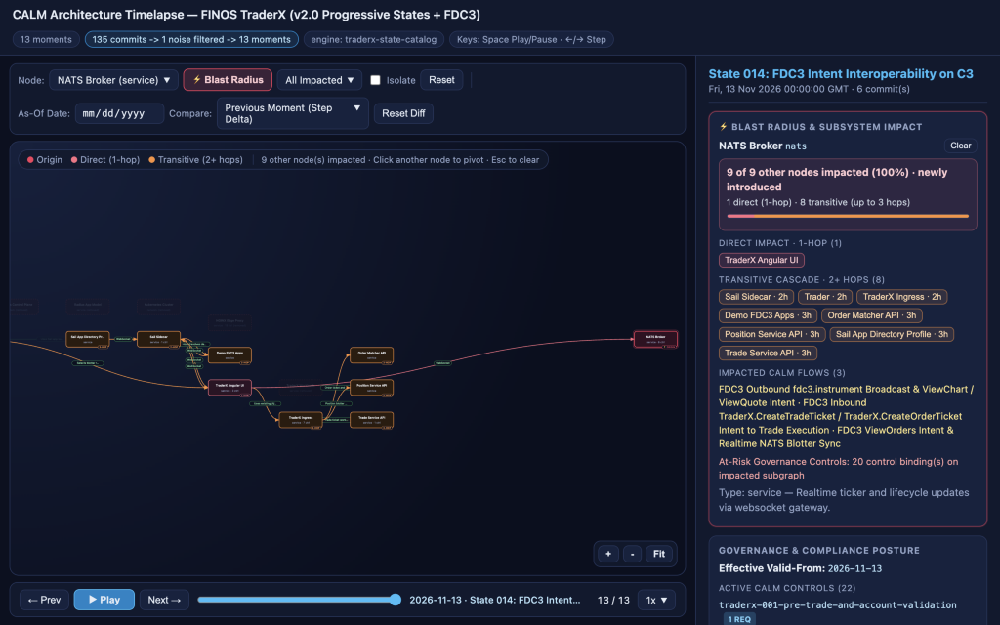

# Mu — CALM Timelapse (`calm-timelapse`)

**Track 3 (Features) · FINOS Fall 2026 Hackathon**

**Team:** mu — Akshar Prabhu Desai ([@aksharprabhudesai](https://github.com/aksharprabhudesai), solo)

**Live Demo Gallery (zero install):** [https://finos-hack.github.io/fall-hackathon-2026-mu/](https://finos-hack.github.io/fall-hackathon-2026-mu/)  
**Walkthrough video (72 s):** [docs/assets/calm-timelapse-demo.mp4](docs/assets/calm-timelapse-demo.mp4) · [Watch MP4 on GitHub Pages](https://finos-hack.github.io/fall-hackathon-2026-mu/assets/calm-timelapse-demo.mp4)

## The pitch

Upstream `@finos/calm-cli` (`calm timeline` / `calm diff --timeline`) requires teams to manually pre-save versioned snapshot files and hand-author `timeline.json`. `calm-timelapse` reconstructs `@finos/calm-cli`-validated CALM `1.2` / `1.3` timelines and point-in-time snapshots directly from existing Git history across one or multiple repositories, filtering pure formatting noise and attaching co-changed Architecture Decision Records (ADRs). It renders a single-file, zero-network HTML player where reviewers and auditors can query any `As-Of Date`, inspect applicable ADRs, Controls, and Flows at that snapshot in time, and click any node for **Multi-Hop CALM Blast Radius** impact analysis.

## Why this matters in financial services

1. **Retroactive architecture & ADR auditability:** Compliance and change-risk reviewers can inspect what a trading, execution, or surveillance topology looked like on any past date (`YYYY-MM-DD`) and see which ADRs and CALM controls applied then—without requiring engineers to have pre-archived JSON snapshots or read raw Git diffs.
2. **Multi-hop failure & change impact:** Clicking any node computes semantic CALM blast radius (`All Impacted`, `Dependents / Failure Cascade`, or `Downstream Flow`), surfacing affected CALM `flows`, at-risk `controls`, and `±Δ vs prev` blast-radius shifts across releases.
3. **Deterministic guardrails over AI assistance:** Matching the `calm init-ai` pattern, the CLI makes zero network or LLM calls (`zero-network-execution`). `--emit-digest` exports compact structural diffs for approved IDE assistants ([`skills/calm-timelapse/SKILL.md`](./skills/calm-timelapse/SKILL.md)), `validateClusterSpecs(0..N-1)` enforces contiguous non-overlapping coverage, and every snapshot is extracted verbatim from Git blobs rather than generated by an LLM.



*Multi-Hop CALM Blast Radius on the interactive stage: highlights `⚡ ORIGIN`, `1-HOP`, and `2-HOP+` impact, affected flows, at-risk controls, and temporal blast-radius delta.*

## FINOS projects & standards connected

| Project / Standard | Role in `calm-timelapse` | Evidence in Repo |
|---|---|---|
| **FINOS CALM (`@finos/calm-schema` & `@finos/calm-cli`)** | Emits and validates `calm-timeline` (`1.2` / `1.3`), `*.architecture.json`, and `*.pattern.json` snapshots; self-models `calm-timelapse` in CALM | [`architecture.calm.json`](./architecture.calm.json), [`.github/workflows/ci.yml`](./.github/workflows/ci.yml) |
| **FINOS TraderX (`finos/traderx`)** | Imports 13 historical architecture states (`001`–`014`), 22 Spec-Kit governance controls, and 8 ADRs into a validated CALM `1.3` timeline | [`src/traderx-importer.ts`](./src/traderx-importer.ts), [`docs/demos/finos-traderx/`](./docs/demos/finos-traderx/) |
| **FINOS FDC3 (`2.2`)** | Translates TraderX FDC3 `2.2` desktop interop contracts (`ViewChart`, `ViewInstrument`, `PlaceOrder`, `fdc3.instrument`, `fdc3.position`) into validated CALM interfaces and flows | [`docs/demos/finos-traderx/finos-traderx.timelapse.html`](https://finos-hack.github.io/fall-hackathon-2026-mu/demos/finos-traderx/finos-traderx.timelapse.html) |
| **FINOS Fluxnova** | Extracts Git timeline and CALM `1.2` control history from `finos/architecture-as-code` Fluxnova KYC platform architecture | [`docs/demos/fluxnova/`](./docs/demos/fluxnova/) |
| **CALM AI (`calm init-ai` pattern)** | Offline diff-digest + IDE skill workflow (`--emit-digest` / `--clusters`) with strict `0..N-1` validation | [`skills/calm-timelapse/SKILL.md`](./skills/calm-timelapse/SKILL.md), [`docs/demos/calm-self/`](./docs/demos/calm-self/) |

## What is real vs. synthetic sample data

- **Real upstream histories & running code:** Full TypeScript CLI (`src/`), standalone SVG/HTML renderer, and 8 real Git history demos extracted from [`finos/architecture-as-code`](https://github.com/finos/architecture-as-code) (`finos-federated`, `api-gateway`, `calm-manual`, `calm-self`, `osff-signup`, `fluxnova`), [`finos/traderx`](https://github.com/finos/traderx) (`finos-traderx`), and this repository (`self-dogfood`).
- **Synthetic benchmark seeds:** [`traderx`](./docs/demos/traderx/) (`npm run demo:traderx`, 40-commit compliance stress test with 5 noise commits filtered) and [`multi-repo`](./docs/demos/multi-repo/) (`npm run demo:multi-repo`, 3-repository federation demonstrating `detailed-architecture` canonical merge vs. peer namespace isolation).

## Five-minute judge walkthrough

1. **Open the live gallery (0 install):** Visit [finos-hack.github.io/fall-hackathon-2026-mu](https://finos-hack.github.io/fall-hackathon-2026-mu/) or watch the [72-second `.mp4` walkthrough](https://finos-hack.github.io/fall-hackathon-2026-mu/assets/calm-timelapse-demo.mp4).
2. **Scrub moments, ADRs & As-Of Date:** Open the [Compliance Benchmark Stage](https://finos-hack.github.io/fall-hackathon-2026-mu/demos/traderx/traderx.timelapse.html), step through moments (`Space` or `←`/`→`), pick an `As-Of Date`, and inspect applicable ADRs, CALM Controls, and Flows in the side panel.
3. **Click any node for Blast Radius:** Click a core service or database node on the canvas, switch between `All Impacted`, `Dependents / Failure Cascade`, and `Downstream Flow`, and toggle `Isolate` (`Esc` to reset).
4. **Inspect multi-repo federation & FDC3 translation:** Open the [3-Repo Federated Stage](https://finos-hack.github.io/fall-hackathon-2026-mu/demos/multi-repo/multi-repo.timelapse.html) (use the `Project` filter to compare isolated vs. merged boundary nodes) and the [FINOS TraderX + FDC3 Stage](https://finos-hack.github.io/fall-hackathon-2026-mu/demos/finos-traderx/finos-traderx.timelapse.html).

To run locally from a fresh clone:

```sh
npm ci && npm run build && npm test
node dist/cli.js --from-git architecture.calm.json -o /tmp/self.timeline.json --timelapse /tmp/self.html --validate
```

## Rubric mapping

| Category | Evidence |
|---|---|
| **1. Ecosystem Integration** | Extends FINOS CALM (`1.2` / `1.3` timelines, architectures, patterns), imports upstream `finos/traderx` Spec-Kit controls + ADRs, translates FINOS FDC3 `2.2` interop contracts into validated CALM flows, models FINOS Fluxnova history, and aligns with `calm init-ai` |
| **2. Technical Execution & Completeness** | Working CLI + offline single-file HTML/SVG player, multi-repo Git extraction with rename tracking and noise filtering, Multi-Hop CALM Blast Radius engine, 10 live interactive demos, 44 automated tests, and 24 `@finos/calm-cli` CI validations |
| **3. Business Value & Financial Applicability** | Solves point-in-time architectural & ADR auditability, cross-team blast-radius change review, and air-gapped governance without manual snapshot archival or external LLM data egress |
| **Bonus: Innovation & Build Velocity** | Agent-accelerated build with deterministic guardrails (`--emit-digest` -> [`SKILL.md`](./skills/calm-timelapse/SKILL.md) -> `validateClusterSpecs(0..N-1)`), guaranteeing verbatim Git-blob snapshots with zero hallucinated topology |

## Verification

- **Build & test suite:** `npm ci && npm run typecheck && npm run build && npm test` passes (`8` test suites, `44` unit and end-to-end tests).
- **Official `@finos/calm-cli@1.72.0` validation:** CI validates [`architecture.calm.json`](./architecture.calm.json), all `10` `docs/demos/*/*.timeline.json` timelines, and all `13` `docs/demos/finos-traderx/snapshots/*.architecture.json` snapshots (`24/24` checks passing with `0` errors and `0` warnings).
- **DCO compliance:** Every commit is signed off (`Signed-off-by`) and verified by the DCO GitHub check.
